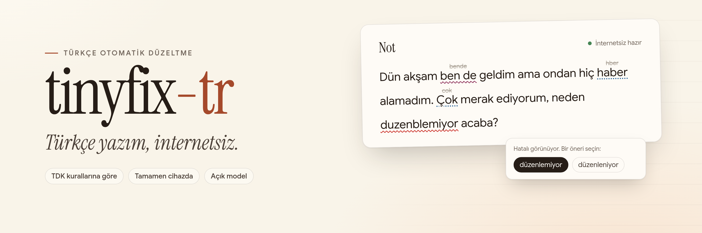

# tinyfix-tr

Türkçe yazım hatalarını TDK kurallarına göre düzelten, tarayıcıda ve Node.js'te **internetsiz** çalışan küçük bir motor. Emin olduğu hatayı düzeltir, emin olamadığı kelimeyi işaretleyip öneri sunar. Metin cihazdan çıkmaz.

**[Canlı demo](https://tdkai.halid.dev)** · **[npm](https://www.npmjs.com/package/tinyfix-tr)** · **[Model (Hugging Face)](https://huggingface.co/imhalid/tinyfix-tr)**

```bash
npm install tinyfix-tr
```

```ts
import { loadTdkai } from "tinyfix-tr";

const tdkai = await loadTdkai();
await tdkai.fix("Bugün cok yorgunum, Ankaraya herkez geldi.");
// "Bugün çok yorgunum, Ankara'ya herkes geldi."
```

API ve seçenekler için [pkg/README.md](pkg/README.md).

## Ne düzeltir

| Tür | Örnek |
|---|---|
| Türkçe karakter | cok → çok, nasil yaptigini → nasıl yaptığını |
| Kesme işareti | Ankaraya → Ankara'ya |
| Bitişik yazılmış | Birşey → Bir şey, geldinmi → geldin mi, diyorki → diyor ki |
| Ayrı yazılmış | hiç bir → hiçbir, Oysa ki → Oysaki, Yerler de → Yerlerde |
| Klavye hatası | yapabiliur → yapabilir, konlarda → konularda |
| Bilinen yazım yanlışı | herkez → herkes, malesef → maalesef |

Konuşma dili kısaltmaları (`noldu → ne oldu`, `burda → burada`) bilerek yazıldığı için varsayılan olarak kapalıdır, `kisaltma` türüyle açılır.

## Nasıl çalışır

1. **Sözlük ve kurallar:** Her kelime için yazılan biçimin ve düzeltme adaylarının Türkçe metinde ne kadar sık geçtiği karşılaştırılır. Aday ancak açık bir farkla öndeyse kelime değiştirilir.
2. **Biçimbilim:** Zemberek tabanlı bir ek denetimi, nadir ama geçerli kelimelerin ("getirsek", "kitabımı") yanlış düzeltilmesini önler.
3. **Bağlam modeli (isteğe bağlı):** 3 MB'lık küçük bir Transformer, `oldu/öldü`, `de/da`, `ki`, `mi` gibi belirsiz durumlarda cümleye bakarak seçim yapar.

Sıklıklar Türkçe Vikipedi ve OpenSubtitles altyazılarından çıkarılan kelime sayımlarından gelir. Metinlerin kendisi dağıtılmaz.

## Sonuçlar

Hiç ayarlanmadığı, ayrı tutulmuş kümelerde ölçüldü. *Düzeltilen* otomatik düzeltilen, *bulunan* ise düzeltilen veya öneriyle işaretlenen hatalardır.

| Küme | Düzeltilen | Bağlamla | Bulunan |
|---|---|---|---|
| Hatalı Vikipedi cümleleri (400) | %84,0 | %89,3 | %98,3 |
| Sohbet yazısı, eksik harfler (811 kelime) | %69,7 | %83,6 | %99,4 |
| Sohbet yazısı, karışık hatalar (602 kelime) | %68,8 | %75,2 | %99,5 |

Doğru metinde yanlış alarm: Vikipedi cümlelerinde 1.000 kelimede yaklaşık 2, temiz sohbet cümlelerinde 0,1. Vikipedi testleri yapay hatalarla üretildiği için gerçek kullanımdan iyimser çıkar.

## Klasörler

| Klasör | İçerik |
|---|---|
| `src/` | Düzeltme motoru: sözlük, kurallar, biçimbilim, bağlam modeli arayüzü |
| `pkg/` | `tinyfix-tr` npm paketi (Web Worker ve isteğe bağlı bağlam modeli dahil) |
| `site/` | İnternetsiz Türkçe yazı uygulaması (SolidJS, Tiptap, service worker) |
| `py/` | Sözlük, test seti ve bağlam modeli eğitim betikleri |
| `bench/` | Ölçüm betikleri ve test setleri |
| `data/` | Kurallar (`data/rules/`) ve biçimbilim sözlüğü |
| `hf/` | Hugging Face model kartı ve görseller |

## Geliştirme

```bash
npm install
npm test                          # motor testleri
npm run build:models              # tarayıcı veri dosyalarını üretir
node bench/run.ts dev             # doğruluk ölçümü
node bench/examples.ts "Yarın Ankaraya gidiyorum."
```

Sözlüğü sıfırdan kurmak için Türkçe Vikipedi'yi `data/raw/trwiki/` içine indirip `uv run --project py python py/build_lexicon.py` çalıştırın. Ayrıntılı deney ve ölçüm notları `NEON-*-NOTES.md` dosyalarında.

## Sınırlar

- Yazılan kelime başka bir geçerli kelimeyse (`sende/ben de`, `oldu/öldü`) yalnızca bağlam modeli açıkken ve emin olduğunda düzeltilir.
- Kurum adlarına gelen eklerde TDK kesme istemez, devlet ve coğrafya adlarında ister. Biçimden ayırt edilemediği için iyelik ekli bu adlara kesme **eklenmez**.
- Konuşma dili yazımlarında ("buluşcaz") işaretleme yapılır ama öneriler zayıf kalabilir.

## Planlananlar

- Yazarken sıradaki kelimeyi veya kelimenin devamını önermek
- Noktadan sonra boşluk (`geldim.Yarın → geldim. Yarın`) ve cümle başında büyük harf
- Kısa kelimelerde yazım hatası (`bne → ben`, `ane → anne`)
- TDK birleşik kelime listesi (`hava alanı → havaalanı`)

## Lisans

Kod MIT. Veri dosyaları Vikipedi'den türetildiği için CC BY-SA 4.0. Biçimbilim [Zemberek-NLP](https://github.com/ahmetaa/zemberek-nlp) (Apache 2.0) sözlüğünden uyarlanmıştır.
