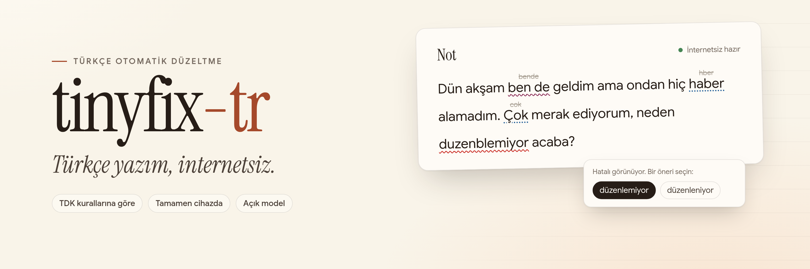

<p align="center">
  
</p>

Türkçe yazım denetleyicileri yalnızca sözlükte olmayan kelimeleri yakalar; `bende` yerine `ben de`, `cok` yerine `çok` gibi hataları ise gözden kaçırır. tinyfix-tr, TDK yazım kurallarını izleyen küçük bir sözlük ve biçimbilim motorudur; isteğe bağlı bir bağlam modeliyle kelimenin çevresine de bakar. Tarayıcıda ve Node.js'te çalışır, yazdığınız metin cihazdan çıkmaz.

```bash
npm install tinyfix-tr
```

```ts
import { loadTdkai } from "tinyfix-tr";

const tdkai = await loadTdkai();
await tdkai.fix("Bugün cok yorgunum, Ankaraya herkez geldi.");
// "Bugün çok yorgunum, Ankara'ya herkes geldi."
```

**[Tarayıcıda deneyin](https://tdkai.halid.dev)**

## Düzeltmeleri alma

`check` yapılacak değişiklikleri ve konumlarını döndürür, `apply` bunları metne uygular:

```ts
const metin = "Birşey söylemek istiyorum ama hiç bir fikrim yok.";
const duzeltmeler = await tdkai.check(metin);
/*
[
  { from: 0, to: 6, original: "Birşey", replacement: "Bir şey", kind: "bitisik-ayri", confidence: 0.986 },
  { from: 30, to: 37, original: "hiç bir", replacement: "hiçbir", kind: "bitisik-ayri", confidence: 0.955 },
]
*/

tdkai.apply(metin, duzeltmeler);
// "Bir şey söylemek istiyorum ama hiçbir fikrim yok."
```

Her düzeltmenin dört türden biri olan bir `kind` değeri vardır (`FixKind`):

| Tür | Ne düzeltir | Örnekler |
|---|---|---|
| `"turkce-karakter"` | Eksik Türkçe karakterler | `cok → çok`, `nasil → nasıl`, `oldu → öldü` |
| `"kesme"` | Özel adlara gelen eklerde eksik kesme işareti | `Ankaraya → Ankara'ya` |
| `"bitisik-ayri"` | Bitişik/ayrı yazım, soru eki, `de/da`, `ki` | `birşey → bir şey`, `hiç bir → hiçbir`, `bende → ben de` |
| `"yazim"` | Klavye hataları ve bilinen yazım yanlışları | `herkez → herkes`, `malesef → maalesef`, `yapabiliur → yapabilir` |

## API

| Çağrı | Ne yapar |
|---|---|
| `loadTdkai(options?)` | Sözlüğü (istenirse bağlam modelini de) indirir ve bir `Tdkai` örneği döndürür. |
| `createTdkai(data, options?)` | Bellekteki veriden eşzamanlı olarak `Tdkai` oluşturur. |
| `tdkai.check(text, options?)` | Çakışmayan, sıralı `Fix[]` listesi döndürür. |
| `tdkai.apply(text, fixes)` | Düzeltmeleri metne uygular; konum veya metin uyuşmazsa hata fırlatır. |
| `tdkai.fix(text, options?)` | `check` ve `apply` adımlarını birlikte çalıştırır. |
| `tdkai.ignore(word)` | Kelimeyi bir daha değiştirmez (Türkçe büyük/küçük harf duyarsız). |
| `tdkai.unignore(word)` | Yoksayılan kelimeyi yeniden denetime açar. |
| `tdkai.setMode(mode)` | Hassasiyet kipini (`"careful"` veya `"balanced"`) günceller. |
| `tdkai.hasContext` | Bağlam modelinin yüklenip yüklenmediğini belirtir. |
| `tdkai.dispose()` | Kaynakları, ONNX oturumunu ve Web Worker'ı sonlandırır. |

### `loadTdkai` seçenekleri

| Seçenek | Varsayılan | Ne yapar |
|---|---|---|
| `baseUrl` | Hugging Face `imhalid/tdk-ai` (sürüme sabit) | Sözlük ve model dosyalarının bulunduğu adres. |
| `context` | `false` | `true` verilirse `context.onnx` indirilir ve `onnxruntime-web` ile bağlam modeli açılır. |
| `mode` | `"careful"` | `"careful"` temkinli, `"balanced"` biraz daha cesur eşikler kullanır. |
| `worker` | `false` | `true` verilirse yükleme, model ve denetim ayrı bir Web Worker içinde çalışır. |
| `wasmPaths` | ORT varsayılanı | `onnxruntime-web` `.wasm`/`.mjs` dosyalarının bulunduğu dizin. |
| `onProgress` | — | `{ ratio, loaded, total, stage, file }` ile yükleme ilerlemesini bildirir. |
| `onWarning` | — | Bağlam modeli yüklenemediğinde uyarı metnini bildirir. |
| `data` | — | Ağ isteği yerine bellekteki ikili (`BinaryData`) veya ham TSV (`RawData`) verisini kullanır. |
| `createWorker` | — | Özel `Worker` örneği sağlayan işlev. |
| `contextModel` | — | Testler veya özel çalışma zamanları için bellekteki bağlam modeli. |
| `loadContextSession` | `createOnnxContextSession` | `context.onnx` baytlarından oturum açan özel yükleyici. |
| `fetch` | `globalThis.fetch` | Özel `fetch` işlevi. |
| `signal` | — | İndirmeyi iptal etmek için `AbortSignal`. |
| `ignored` | — | Başlangıçta yoksayılacak kelimeler. |

### `check` seçenekleri

| Seçenek | Ne yapar |
|---|---|
| `range` | Yalnızca `[from, to)` aralığıyla kesişen düzeltmeleri döndürür; metnin kalanı bağlam olarak okunur. |
| `kinds` | Yalnızca belirtilen `FixKind` türlerini döndürür. |
| `mode` | Yalnızca bu çağrı için geçici kip. |

## Yazarken düzeltme

Kullanıcı bir kelimeyi bitirdiğinde tüm belgeyi yeniden denetlemek yerine yalnızca o aralığı kontrol edin. Metnin geri kalanı (cümle başı, noktalama, çevredeki kelimeler) bağlam olarak okunur:

```ts
const paragraf = "Sen geldinmi?";
const fixes = await tdkai.check(paragraf, {
  range: [4, 12], // yalnızca "geldinmi"; "?" bağlam olarak okunur
  kinds: ["turkce-karakter", "kesme", "bitisik-ayri", "yazim"],
});
```

Kullanıcı bir düzeltmeyi geri aldığında aynı kelimeyi tekrar değiştirmemek için `ignore` çağırın:

```ts
tdkai.ignore(fix.original);
```

## Ne kadar iyi çalışıyor

Hiç ayarlanmadığı, ayrı tutulmuş test kümelerinde ölçüldü. *Düzeltilen*, otomatik düzeltilen; *bulunan* ise düzeltilen veya öneriyle işaretlenen hatalardır.

| Küme | Düzeltilen (çekirdek) | Düzeltilen (bağlamla) | Bulunan |
|---|---|---|---|
| Hatalı Vikipedi cümleleri (400) | %84,0 | %89,3 | %98,3 |
| Sohbet yazısı, eksik harfler (811 kelime) | %69,7 | %83,6 | %99,4 |
| Sohbet yazısı, karışık hatalar (602 kelime) | %68,8 | %75,2 | %99,5 |

Doğru metinde yanlış alarm: Vikipedi cümlelerinde 1.000 kelimede yaklaşık 2 (çoğunlukla nadir özel adlar ve teknik terimler), temiz sohbet cümlelerinde 1.000 kelimede 0,1. Ayrıntılar [model kartında](https://huggingface.co/imhalid/tdk-ai).

## Dokunmadıkları

- Kod parçaları (satır içi ve blok)
- Adresler, dosya yolları, URL'ler ve sayılar
- Özel adlar, yabancı kelimeler ve kısaltmalar (emin olamadığı kelimeyi düzeltmez)
- `ignore` ile yoksayılan kelimeler

`from` ve `to` değerleri, JavaScript dizelerindeki gibi UTF-16 kod birimi sırasıdır.

## Ne indirir

Çekirdek sözlük ilk kullanımda [Hugging Face](https://huggingface.co/imhalid/tdk-ai) üzerinden indirilir: yaklaşık 6 MB (sıkıştırılmış 3,5 MB). `context: true` verirseniz 3 MB'lık bağlam modeli de iner. Her paket sürümü depodaki belirli bir revizyonu yükler, bu yüzden model güncellense bile eski sürümler bozulmaz.

Dosyaları kendi sunucunuzdan vermek isterseniz `lexicon.bin`, `morph.bin`, `known.tsv` (ve bağlam modeli için `context.onnx`) dosyalarını depodan indirip bir klasöre koyun ve adresi verin:

```ts
const tdkai = await loadTdkai({ baseUrl: "/models/" });
```

`context: true` verilmezse `onnxruntime-web` hiç yüklenmez. Verildiğinde dinamik `import()` ile yüklenir; `context.onnx` bulunamazsa veya ONNX oturumu açılamazsa paket uyarı verir (`console.warn` ve `onWarning`) ve sözlük kurallarıyla devam eder (`tdkai.hasContext === false`). `worker: true` Vite ve webpack gibi paketleyicilerde paketin kendi worker dosyasını otomatik başlatır. Worker dosyasını kendiniz bağlamak isterseniz `tinyfix-tr/worker` girişini kullanabilirsiniz:

```ts
const worker = new Worker(new URL("tinyfix-tr/worker", import.meta.url), { type: "module" });
```

## Nerede çalışır

Tarayıcılar, Web Worker'lar ve Node.js 22 veya üstü. Yalnızca Türkçe.

## Geliştirme

```bash
npm test        # birim testleri (node --test)
npm run check   # TypeScript tür denetimi
npm run build   # dist/ klasörüne derleme
```

Demo sayfası: [tdkai.halid.dev](https://tdkai.halid.dev).

## Lisans

MIT.
